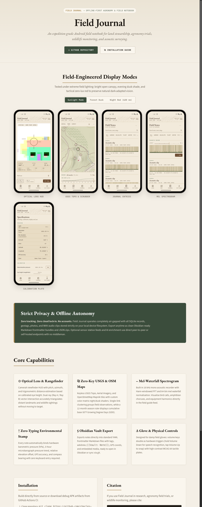
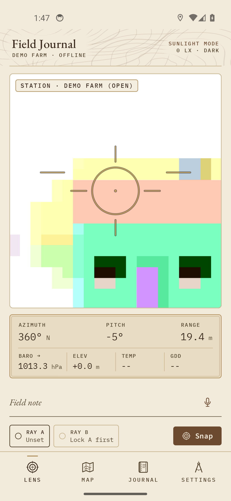
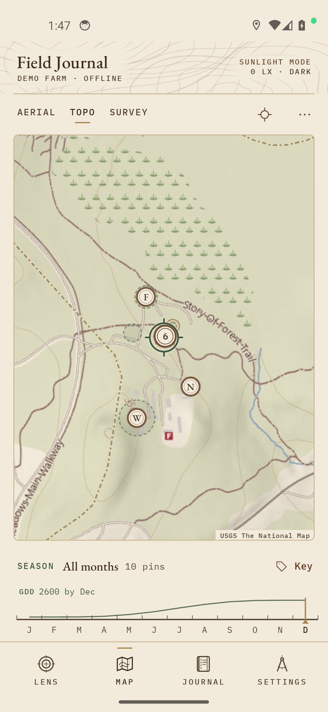
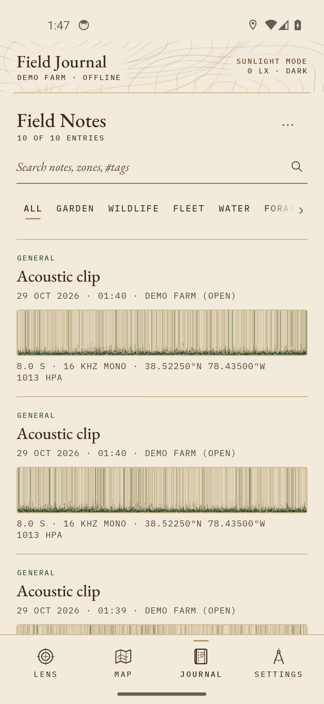
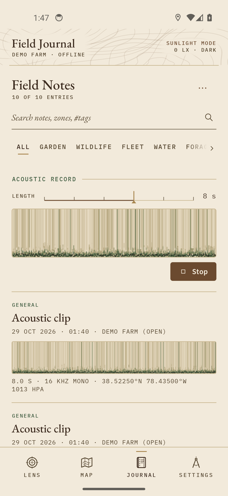
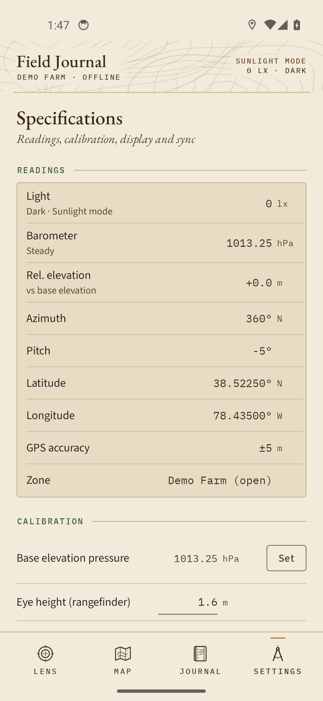
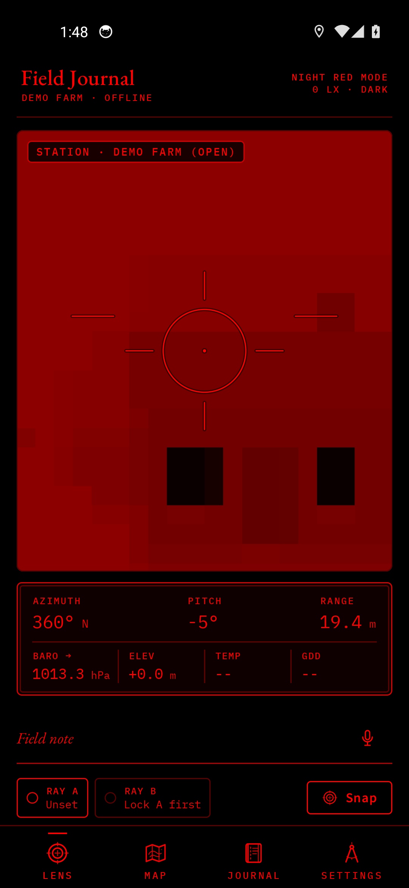

# Field Journal

[](https://github.com/charles-forsyth/field-journal/actions/workflows/ci.yml)
[](https://opensource.org/licenses/MIT)
[](https://github.com/charles-forsyth/field-journal/releases)
[](https://developer.android.com)

An offline-first, expedition-grade Android field notebook for property management, agronomy trials, wildlife monitoring, acoustic surveying, and geospatial tracking. Built with Kotlin, Jetpack Compose (Material 3), CameraX, SQLite, and osmdroid.



## Highlights

- **Strictly Offline-First & Private:** Zero account requirement, zero analytics, zero cloud dependencies. All data (SQLite records, geotags, photos, WAV audio clips) stays strictly on your local device filesystem.
- **Three Lux-Driven Display Modes:** Automatically adapts between **Sunlight** (parchment/cream, &ge;10,000 lx), **Forest Dusk** (dark loden green, 10–9,999 lx), and **Night Red** (pure 620 nm red monochrome, &lt;10 lx to preserve scotopic night vision).
- **Zero-Typing Environmental Stamp:** Every observation automatically binds barometric pressure (hPa), 3-hour microbarograph trend, relative elevation offset, GPS accuracy, and compass bearing.
- **Optical Lens HUD & Dual-Ray Triangulation:** CameraX viewfinder HUD with pitch, azimuth, trigonometric ground distance estimation, and dual-ray (Ray A / Ray B) vector intersection to pinpoint remote sightings without walking to target.
- **Keyless USGS & OSM Basemaps:** Offline-capable caching of USGS Topographic, USGS Aerial Imagery, and OpenStreetMap Mapnik tiles with custom color-matrix dusk/night shaders, spatial clustering, and a 12-month season scrubber displaying cumulative base-50°F Growing Degree Days (GDD).
- **16 kHz Acoustic Mel-Waterfall Spectrogram:** Integrated acoustic recorder with Hann-windowed FFT and 64-bin mel waterfall normalisation for bird vocalisation, amphibian chorus, and mechanical harmonic analysis.
- **Obsidian Vault Markdown Export:** One-tap export to clean YAML frontmatter Markdown files with tags, wikilinks (`[[Vault: Note]]`), GPS coordinates, and media attachments.
- **Glove-Friendly Physical Controls:** Volume keys double as tactile triggers (hold Vol− for offline speech recognition, tap Vol+ for photo capture).

---

## Screenshots

| Optical Lens HUD | USGS Topo & Scrubber | Journal Feed |
| :---: | :---: | :---: |
|  |  |  |

| Mel Spectrogram | Specifications & Calibration | Night Red Mode (620 nm) |
| :---: | :---: | :---: |
|  |  |  |

---

## Architecture & Codebase Layout

```
app/src/main/java/io/github/charlesforsyth/fieldjournal/
├── core/                  # Pure Kotlin domain logic (unit-tested, zero Android deps)
│   ├── Fft.kt             # Radix-2 FFT, Hann window, mel filterbank & normalisation
│   ├── GeoMath.kt         # Haversine, bearing, ENU tangent-plane triangulation, baro elevation
│   ├── Model.kt           # Data classes, deterministic NoteParser, Markdown export formatting
│   ├── PaletteSpec.kt     # WCAG AA contrast mathematics, 3 display palettes, UI text roles
│   ├── PinClusters.kt     # Screen-space Web-Mercator spatial single-link clustering
│   ├── Readouts.kt        # Instrument plate formatting & DotFlow metadata lines
│   ├── StationParse.kt    # Telemetry and Open-Meteo soil moisture/temp parsing
│   ├── ThemeMode.kt       # Lux threshold resolver and ColorMatrix tile shaders
│   ├── TileUrls.kt        # Keyless USGS TNM & OSM tile endpoints
│   └── Zones.kt           # Built-in demo zones, custom zone resolution, geo-reminders
├── data/                  # Device persistence and I/O
│   ├── EnvStamp.kt        # Asynchronous multi-sensor stamp aggregation
│   ├── Net.kt             # Read-only station telemetry, Open-Meteo soil, optional AI/MQTT
│   ├── Prefs.kt           # SharedPreferences + EncryptedSharedPreferences (AI key)
│   ├── SensorHub.kt       # Rotation vector, barometer, light sensor, location provider
│   └── Store.kt           # SQLiteOpenHelper (plain SQLite, schema v1) + demo seed entries
└── ui/                    # Jetpack Compose UI
    ├── CameraHudScreen.kt # CameraX viewfinder HUD, reticle, instrument plate, ray controls
    ├── Icons.kt           # Custom engraved vector line icons
    ├── JournalScreen.kt   # Searchable feed, filter pills, acoustic recorder modal
    ├── PropertyMapScreen.kt# osmdroid MapView, USGS/OSM layers, season scrubber, pin clustering
    ├── SettingsScreen.kt  # Ledger readings plate, home property calibration, sync settings
    ├── Spectrogram.kt     # 60 fps Canvas mel-waterfall audio renderer
    ├── Theme.kt           # Compose ColorScheme and typography scales
    └── Widgets.kt         # Tactile buttons, gear tags, ledger rows, contour band
```

---

## Building from Source

### Prerequisites
- JDK 17 (e.g. `brew install openjdk@17`)
- Android SDK (API 35, Build-Tools 34.0.0+)

### Commands

```bash
# Set environment
export JAVA_HOME=$(brew --prefix openjdk@17)/libexec/openjdk.jdk/Contents/Home
export ANDROID_HOME=$HOME/Library/Android/sdk

# Run unit tests
./gradlew test

# Build debug APK
./gradlew assembleDebug

# Install on connected device or emulator
adb install app/build/outputs/apk/debug/app-debug.apk
```

---

## Signing for Release

By default, open-source builds use standard Android debug signing so the repository builds out-of-the-box in GitHub Actions CI.

To configure your own release key:

1. Generate a keystore:
   ```bash
   keytool -genkey -v -keystore release.jks -keyalg RSA -keysize 4096 -validity 10000 -alias fieldjournal
   ```
2. Configure signing in `app/build.gradle.kts` or supply via environment variables / Gradle properties:
   ```kotlin
   signingConfigs {
       create("release") {
           storeFile = file(System.getenv("KEYSTORE_PATH") ?: "release.jks")
           storePassword = System.getenv("KEYSTORE_PASSWORD")
           keyAlias = System.getenv("KEY_ALIAS") ?: "fieldjournal"
           keyPassword = System.getenv("KEY_PASSWORD")
       }
   }
   ```
3. Build and verify:
   ```bash
   ./gradlew assembleRelease
   apksigner verify app/build/outputs/apk/release/app-release.apk
   ```

---

## Citation

If you use Field Journal for agronomy research, academic field trials, wildlife tracking, or ecological surveying, please cite:

```bibtex
@software{forsyth2026fieldjournal,
  author       = {Forsyth, Charles E. III},
  title        = {Field Journal: an offline-first Android field notebook for land, wildlife and agronomy},
  version      = {1.2.0},
  year         = {2026},
  doi          = {pending},
  url          = {https://github.com/charles-forsyth/field-journal}
}
```

---

## Font Licenses

All bundled typefaces are open source under the SIL Open Font License (OFL):
- **EB Garamond** (Georg Duffner, Octavio Pardo) — `licenses/OFL-EBGaramond.txt`
- **Source Sans 3** (Paul D. Hunt / Adobe) — `licenses/OFL-SourceSans3.txt`
- **IBM Plex Mono** (Mike Abbink / Bold Monday) — `licenses/OFL-IBMPlexMono.txt`

## License

This project is licensed under the [MIT License](LICENSE).
Copyright &copy; 2026 Charles Forsyth.
